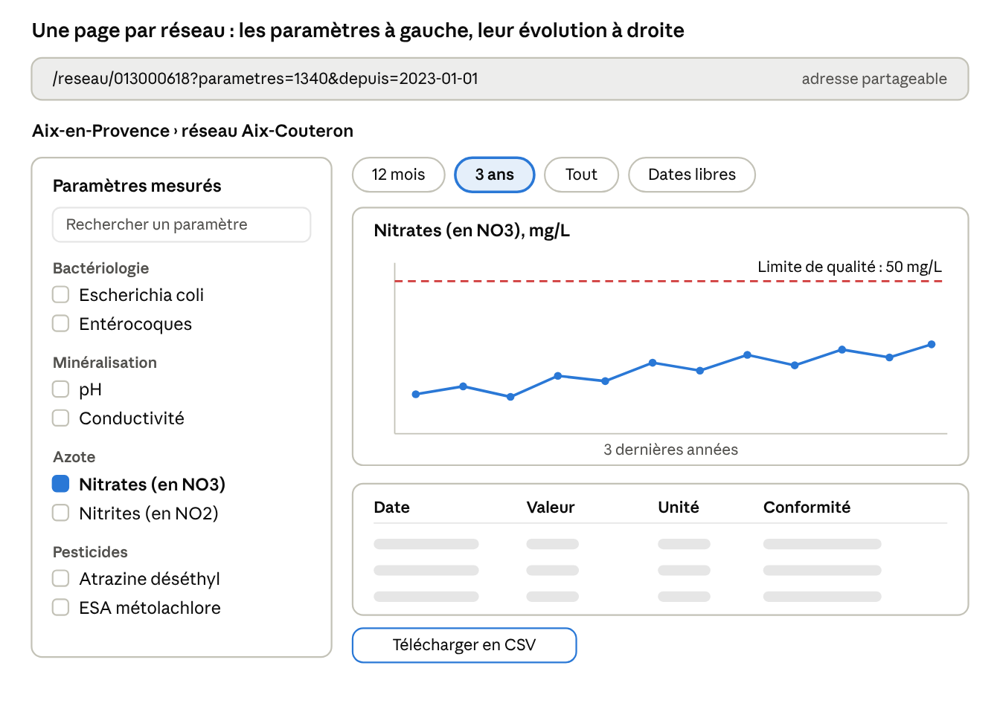

# Suivi de la qualité de l'eau potable

Sujet de projet BUT2 - version du 12 octobre 2026

Vous allez construire une application web où chacun peut suivre dans le temps la qualité de l'eau de son robinet. Les résultats des analyses sont déjà publics, mais le site officiel ne les montre qu'un bulletin à la fois. Votre outil les rassemble pour qu'on voie d'un coup d'œil comment un paramètre évolue et à quelle distance il se trouve des limites autorisées.

Le commanditaire est Samuel Busson, chercheur au Cerema, un établissement public d'expertise sur l'aménagement et l'environnement.

Ce sujet est long. Pour une première lecture, les sections « Contexte », « Objectif et périmètre », « Utilisateurs et parcours » et « Premiers pas » suffisent. Lisez « Points délicats » avant d'écrire du code. Le reste se consulte au fil du projet, quand la question se pose.

## Contexte

**Le contrôle sanitaire.** L'eau distribuée en France est analysée régulièrement par les Agences régionales de santé (ARS), à une fréquence qui dépend de la taille du réseau : de quelques prélèvements par an pour un petit village à plusieurs par jour pour une grande ville. Chaque prélèvement porte sur une sélection de paramètres : bactéries, paramètres physico-chimiques (pH, conductivité, nitrates), métaux, pesticides et leurs produits de dégradation. La sélection change d'un prélèvement à l'autre.

Un réseau, aussi appelé unité de distribution (UDI), est l'ensemble des canalisations qui apportent une eau de même qualité à un groupe d'habitants. Une petite commune a souvent un seul réseau ; une grande ville en a un par quartier.

**Ce que propose le site actuel.** Sur la [page du ministère de la Santé](https://sante.gouv.fr/sante-et-environnement/eaux/eau), l'usager choisit sa région, son département, sa commune puis son réseau. Il obtient le dernier bulletin d'analyse sur une page dont l'adresse est toujours la même (`orobnat.sante.gouv.fr/orobnat/rechercherResultatQualite.do`). Il ne peut donc pas la mettre en favori ni la partager. Le bouton « bulletin précédent » remonte d'une analyse, sur la même adresse.

**Pourquoi c'est insuffisant.** Pour savoir comment le taux de nitrates a évolué depuis trois ans, il faut ouvrir les bulletins un par un, repérer ceux qui contiennent le paramètre et recopier les valeurs à la main. Un citoyen, un élu ou un chercheur n'a aucun moyen simple de voir si une valeur se rapproche de la limite autorisée, ni de savoir à quoi sert un pesticide détecté dans son eau.

Les mêmes données sont pourtant ouvertes et interrogeables par programme (section suivante). Le problème n'est pas l'accès aux données, c'est leur présentation. Retenez-le pour toute la suite : la personne qui utilisera votre application n'est ni chimiste ni informaticienne.

## Les données disponibles

Toutes les analyses publiées depuis le 1er janvier 2016 sont accessibles par une API publique, sans clé : votre application n'a pas besoin de lire le site du ministère page par page.

| Source | Contenu | Accès | Mise à jour |
| --- | --- | --- | --- |
| [API Hub'Eau « Qualité de l'eau potable »](https://hubeau.eaufrance.fr/page/api-qualite-eau-potable) | Réseaux par commune, prélèvements et résultats d'analyse depuis 2016 | API REST, JSON ou CSV, sans authentification | Mensuelle |
| [Résultats du contrôle sanitaire, commune par commune](https://www.data.gouv.fr/datasets/resultats-du-controle-sanitaire-de-leau-distribuee-commune-par-commune) | Les mêmes données en fichiers annuels (prélèvements, résultats, liens commune-réseau), issues de la base SISE-Eaux | Archives ZIP de 240 à 310 Mo par an | Mensuelle |
| [Catalogue E-Phy (Anses)](https://www.data.gouv.fr/datasets/donnees-ouvertes-du-catalogue-e-phy-des-produits-phytopharmaceutiques-matieres-fertilisantes-et-supports-de-culture-adjuvants-produits-mixtes-et-melanges) | Produits phytopharmaceutiques autorisés, substances actives, usages autorisés par culture | Archive ZIP de fichiers CSV (UTF-8) | Hebdomadaire |
| [Base C3PO (OFB)](https://www.data.gouv.fr/datasets/6757851437fe4bca66ab3569/) | Substances phytosanitaires enrichies : codes Sandre, numéro CAS, statut européen, toxicité, lien avec les cultures | Archive ZIP de fichiers CSV | Version d'octobre 2024 |

Quelques sigles de ce tableau reviennent dans tout le sujet :

- **Hub'Eau** est la plateforme d'API publiques sur l'eau, gérée par l'Office français de la biodiversité (OFB).
- **SISE-Eaux** est la base nationale du ministère de la Santé où les ARS enregistrent les analyses.
- **E-Phy** est le catalogue officiel des produits phytopharmaceutiques (les pesticides agricoles) autorisés en France. Il est tenu par l'Anses, l'Agence nationale de sécurité sanitaire.
- **Le Sandre** est le service qui attribue un code unique à chaque paramètre mesuré dans l'eau : 1340 pour les nitrates, par exemple.
- **Le numéro CAS** est l'identifiant international d'une substance chimique : 14797-55-8 pour les nitrates. C'est lui qui fait le lien entre une molécule mesurée dans l'eau et une substance du catalogue E-Phy.

### L'API Hub'Eau

L'API propose deux opérations, testées le 12 octobre 2026.

- `communes_udi` donne les réseaux qui desservent une commune. Pour Aix-en-Provence (`code_commune=13001`), elle renvoie 66 lignes : un réseau par quartier, avec `code_reseau`, `nom_reseau`, `nom_quartier`.
- `resultats_dis` donne les résultats d'analyse, filtrables par `code_commune`, `code_reseau`, `code_parametre`, date de prélèvement. Pour le réseau Aix-Couteron, elle renvoie 5 132 résultats, tous paramètres confondus ; pour les nitrates sur toute la commune, 496 résultats entre janvier 2016 et juillet 2026.

Le `code_commune` est le code INSEE de la commune, à ne pas confondre avec son code postal : 13001 pour Aix-en-Provence, dont le code postal est 13090 ou 13100.

Chaque résultat contient déjà tout ce que le sujet demande d'afficher :

| Champ | Exemple | Usage |
| --- | --- | --- |
| `code_parametre`, `libelle_parametre` | 1340, Nitrates (en NO3) | Identifier le paramètre (code Sandre) |
| `code_parametre_cas` | 14797-55-8 | Faire le lien avec une substance active phytosanitaire |
| `resultat_numerique` | 0.8 | Tracer la courbe |
| `resultat_alphanumerique` | 0,80 ou <0,02 | Valeur telle que publiée, avec les mentions « inférieur à » |
| `libelle_unite` | mg/L | Axe du graphique |
| `limite_qualite_parametre` | <=50 mg/L | Ligne de limite sur le graphique |
| `reference_qualite_parametre` | (vide pour les nitrates) | Ligne de référence sur le graphique |
| `date_prelevement` | 2026-07-23T09:31:00Z | Axe du temps |
| `conclusion_conformite_prelevement` | Conforme aux limites de qualité... | Avis sanitaire du bulletin |
| `reseaux` | Aix-Couteron, 013000618 | Réseau concerné |

**Limites de l'API à connaître.** Une requête ne peut pas parcourir plus de 20 000 résultats (numéro de page × taille de page). Un grand réseau sur dix ans dépasse ce seuil si l'on ne filtre ni par paramètre ni par date. Les données ont un à deux mois de retard : la dernière alimentation du 15 septembre 2026 s'arrête aux prélèvements de juillet.

## Objectif et périmètre

Vous développez un site web où l'on choisit une commune et un réseau, puis un ou plusieurs paramètres, et où l'on voit leur évolution sur la période voulue, comparée aux limites réglementaires.

L'application remplit quatre fonctions :

1. **Trouver son eau** : choisir une commune par son nom, puis le réseau qui dessert son quartier.
2. **Voir ce qui est mesuré** : afficher la liste de tous les paramètres analysés sur ce réseau, regroupés par famille, avec le nombre de mesures et la date de la dernière.
3. **Suivre dans le temps** : pour les paramètres choisis et la période choisie, afficher un graphique et un tableau des valeurs, avec la limite et la référence de qualité.
4. **Comprendre** : pour un pesticide, indiquer s'il est encore autorisé et sur quelles cultures, par un lien vers le catalogue officiel E-Phy.

**Une exigence transversale : chaque vue a sa propre adresse.** La commune, le réseau, les paramètres et la période sont dans l'URL, par exemple `/reseau/013000618?parametres=1340,1302&depuis=2023-01-01`. On peut la mettre en favori, l'envoyer par courriel, la coller dans un article. C'est le premier défaut du site actuel, et le plus simple à corriger.

**Ce qui est dans le périmètre.** Toute la France, les résultats publiés depuis 2016, les paramètres physico-chimiques, bactériologiques et pesticides, le lien vers E-Phy.

**Ce qui n'y est pas.** L'interprétation sanitaire : l'application affiche les valeurs et les limites, elle ne dit pas si l'eau est « bonne » ou « mauvaise » au-delà de l'avis officiel du bulletin. Les eaux de baignade, les eaux en bouteille et l'eau brute des captages (avant traitement) sont hors sujet.

**Le critère de réussite.** Un habitant qui ne connaît pas le code de son réseau obtient en moins d'une minute la courbe des nitrates de son eau sur trois ans, avec la limite tracée, et peut envoyer le lien à quelqu'un.

## Utilisateurs et parcours

Le site s'adresse d'abord à des personnes qui ne connaissent ni les codes Sandre ni le vocabulaire du contrôle sanitaire.

| Utilisateur | Ce qu'il cherche |
| --- | --- |
| Habitant | Savoir ce qu'il y a dans son eau, si ça change, si c'est loin des limites |
| Élu, journaliste, association | Suivre un paramètre sur une commune, comparer des réseaux, partager un graphique |
| Chercheur, bureau d'études | Récupérer rapidement une série de mesures propre, en CSV |

Aucun compte n'est nécessaire : tout est public.

Voici le parcours type d'un habitant.

1. L'usager tape le début du nom de sa commune ; une liste de suggestions s'affiche, avec le département pour distinguer les homonymes.
2. La page de la commune liste ses réseaux avec les quartiers qu'ils desservent. S'il n'y en a qu'un, on passe directement à l'étape suivante.
3. La page du réseau affiche à gauche la liste de tous les paramètres déjà mesurés, groupés par famille, avec un champ de recherche.
4. L'usager coche un ou plusieurs paramètres et choisit une période (12 mois, 3 ans, tout, ou des dates libres).
5. Le graphique et le tableau s'affichent à droite, avec la limite de qualité en ligne continue. L'adresse de la page change en même temps.
6. Pour un pesticide, un lien mène à sa fiche E-Phy et un encadré résume les cultures sur lesquelles il est autorisé.
7. L'usager copie l'adresse, ou télécharge les valeurs affichées en CSV.

Cette ébauche sert à fixer les idées, ce n'est pas une maquette à reproduire. La courbe est schématique, et c'est à vous de concevoir la disposition.

## Fonctionnalités attendues

Faites fonctionner le socle de bout en bout pour un paramètre et un réseau avant d'attaquer la moindre extension : une courbe de nitrates juste, avec sa limite et une adresse partageable, vaut mieux qu'un tableau de bord incomplet. La colonne « Niveau » donne l'ordre, le socle d'abord, puis les extensions 1, puis les extensions 2.

| Fonction | Ce que ça recouvre | Niveau |
| --- | --- | --- |
| Recherche de commune | Saisie avec suggestions, homonymes distingués par le département | Socle |
| Choix du réseau | Liste des réseaux de la commune avec les quartiers desservis | Socle |
| Liste des paramètres | Tous les paramètres déjà mesurés sur le réseau, nombre de mesures, date de la dernière, recherche par nom | Socle |
| Choix de la période | Raccourcis (12 mois, 3 ans, tout) et dates libres | Socle |
| Graphique d'évolution | Valeurs dans le temps, limite et référence de qualité en lignes horizontales | Socle |
| Tableau des valeurs | Date, valeur telle que publiée, unité, conformité du prélèvement | Socle |
| Adresses partageables | Commune, réseau, paramètres et période dans l'URL ; la page se reconstruit à partir de l'adresse seule | Socle |
| Export | Les valeurs affichées en CSV | Socle |
| Plusieurs paramètres | Plusieurs courbes, un graphique par unité ou des petits graphiques alignés sur le même axe du temps | Extension 1 |
| Familles de paramètres | Regroupement lisible : bactériologie, minéralisation, nitrates et azote, métaux, pesticides | Extension 1 |
| Lien E-Phy | Pour un pesticide : fiche E-Phy, statut d'autorisation, cultures autorisées | Extension 1 |
| Dernier bulletin | Vue résumée du dernier prélèvement, équivalent lisible du site actuel | Extension 1 |
| Comparaison de réseaux | Un même paramètre sur plusieurs réseaux ou communes | Extension 2 |
| Carte | Communes colorées selon la dernière valeur d'un paramètre, à l'échelle d'un département | Extension 2 |
| Alertes | Signaler les paramètres dont la tendance se rapproche de la limite | Extension 2 |

## Points délicats

Afficher une courbe est facile ; afficher une courbe juste demande de régler six problèmes de données. Étudiez-les avant de coder l'interface.

### Les six problèmes

1. **Les limites sont du texte.** Le champ `limite_qualite_parametre` vaut par exemple `<=50 mg/L`. Pour tracer une ligne, il faut en extraire un opérateur, un nombre (avec virgule décimale) et une unité. Certains paramètres ont sans doute une plage plutôt qu'un seuil, comme le pH : faites l'inventaire de toutes les formes de limites présentes dans les données avant d'écrire l'analyseur. La limite peut aussi être vide, comme la référence pour les nitrates.
2. **Limite et référence ne disent pas la même chose.** La limite de qualité est un seuil sanitaire : la dépasser rend l'eau non conforme. La référence de qualité est un indicateur de bon fonctionnement des installations (température, couleur, conductivité) : la dépasser ne signifie pas un risque pour la santé. Le graphique doit les distinguer visuellement et l'expliquer en une phrase.
3. **Beaucoup de valeurs sont « inférieures à ».** Pour les pesticides et les métaux, la plupart des résultats sont du type `<0,02` : la molécule est peut-être présente, mais en quantité trop faible pour que le laboratoire puisse la mesurer. On dit qu'elle est sous le seuil de quantification, ce qui ne veut pas dire qu'elle vaut zéro. Vérifiez ce que contient alors `resultat_numerique`, et affichez ces points autrement (symbole creux, bande sous le seuil) au lieu de les tracer comme des valeurs mesurées. Les traiter comme zéro ou comme le seuil fausse la lecture.
4. **Les mesures sont irrégulières.** Un paramètre peut être mesuré tous les mois puis une fois par an. Le graphique ne doit pas relier deux points séparés de deux ans par une ligne qui suggère une évolution continue, et l'interface doit dire combien de mesures existent sur la période. Plusieurs prélèvements le même jour, en des points différents du réseau, sont possibles.
5. **Une analyse peut concerner plusieurs réseaux.** Un prélèvement peut être fait sur une installation en amont, commune à plusieurs réseaux (champs `code_installation_amont`, `nom_installation_amont`). Le champ `reseaux` est une liste. Décidez comment l'afficher pour que l'usager comprenne d'où vient la mesure.
6. **Plusieurs paramètres n'ont pas la même unité.** Nitrates en mg/L, pH sans unité, pesticide en µg/L (mille fois plus petit que le mg/L) : les mettre sur le même axe n'a pas de sens, et un double axe vertical se lit mal. La solution habituelle est une série de petits graphiques empilés, chacun avec son axe et sa limite, partageant le même axe du temps. Vérifiez aussi qu'un même paramètre garde la même unité sur toute la période.

### Le cas des pesticides

Le lien vers les cultures autorisées passe par le numéro CAS : `code_parametre_cas` dans les résultats, et le fichier `substance_active` du catalogue E-Phy. Trois difficultés vous attendent.

- **Les métabolites.** Une bonne partie des molécules détectées ne sont pas des substances actives mais leurs métabolites, c'est-à-dire les molécules qui se forment quand la substance se dégrade dans le sol ou dans l'eau (par exemple les métabolites du métolachlore ou du chlorothalonil). Ils ne figurent pas dans E-Phy : il faut une table qui relie chaque métabolite à sa substance mère. La [base C3PO](https://www.data.gouv.fr/datasets/6757851437fe4bca66ab3569/) et le référentiel Sandre sont les premiers endroits où la chercher.
- **Les substances interdites.** Certaines molécules interdites depuis longtemps sont encore retrouvées dans l'eau. E-Phy les connaît comme retirées : l'interface doit afficher « interdite depuis … » plutôt qu'une liste de cultures vide.
- **La formulation.** « Autorisé sur le blé et la vigne » ne veut pas dire « vient des champs de blé voisins ». Le texte doit rester factuel et renvoyer à la fiche officielle, sans conclure sur l'origine de la pollution. Les données E-Phy ne sont d'ailleurs pas opposables, c'est-à-dire qu'elles n'ont pas de valeur juridique : seules les décisions du registre des autorisations font foi.

## Repères techniques

La première décision d'architecture est le choix entre interroger l'API à chaque visite et importer les données chez vous. Prenez-la et justifiez-la en début de projet, après quelques mesures.

| Approche | Avantages | Inconvénients |
| --- | --- | --- |
| Interroger Hub'Eau à la volée, avec un cache côté serveur | Rien à stocker ni à mettre à jour, démarrage rapide | Dépend de la disponibilité de l'API ; lister les paramètres d'un réseau oblige à parcourir des milliers de résultats ; plafond de 20 000 résultats par requête |
| Importer les fichiers annuels de data.gouv.fr dans une base | Requêtes libres (liste des paramètres, statistiques), rapide, indépendant | Environ 300 Mo compressés par an, import mensuel à automatiser, volume à gérer |
| Mixte | Import limité à une région pour la démonstration, API pour le reste | Deux chemins de code à maintenir |

Un bon début : commencez par l'API, mesurez le temps de réponse pour un grand réseau, puis décidez. Le catalogue E-Phy, lui, est petit (4 Mo) et s'importe dans tous les cas, avec une mise à jour hebdomadaire.

### Points techniques à anticiper

- Pour la recherche de commune, utilisez l'[API Découpage administratif](https://geo.api.gouv.fr/decoupage-administratif) (`geo.api.gouv.fr`). Elle fournit les communes avec leur code INSEE et sait chercher par début de nom. Le code INSEE sert ensuite de `code_commune` pour Hub'Eau.
- Filtrez toujours vos requêtes à Hub'Eau par réseau, paramètre et date, et ne demandez que les champs utiles (paramètre `fields`). Gérez la pagination et les erreurs : l'API peut être lente ou indisponible, et l'interface doit le dire proprement.
- Mettez les réponses en cache. Les données ne changent qu'une fois par mois : une réponse gardée plusieurs jours n'est pas périmée. C'est ce qui rend l'approche « à la volée » viable.
- Pour les graphiques, prenez une bibliothèque JavaScript (Chart.js, Apache ECharts, Observable Plot) qui sait faire trois choses : un axe du temps réel, des lignes de seuil et des points de styles différents. Vérifiez-le dès le début.
- Concevez le schéma d'URL avant les écrans. Le bouton « précédent » du navigateur doit fonctionner, et une adresse copiée doit redonner exactement la même vue.
- Pensez à l'accessibilité, car le public est large : un graphique a toujours son tableau équivalent, les couleurs ne sont pas le seul moyen de distinguer limite et référence, et le site fonctionne sur téléphone.
- Écrivez comme des fonctions pures l'analyse des limites (`<=50 mg/L`), le traitement des valeurs « inférieures à » et la correspondance métabolite vers substance : elles reçoivent une valeur, rendent un résultat, et ne touchent à rien d'autre. Testez-les avec des cas réels tirés de l'API, c'est là que les tests ont le plus de valeur.

### En PHP sans framework

L'application est écrite en PHP, sans framework : la pile technique est fixée par l'équipe pédagogique. Ce que le framework aurait apporté, vous l'organisez vous-mêmes, et vous le décidez dès le début.

- Donnez à l'application un point d'entrée unique (`index.php`) qui aiguille les requêtes, et séparez nettement trois couches : la logique métier (analyse des limites, valeurs « inférieures à », métabolites), l'accès aux données (Hub'Eau, cache, base), les pages. La logique métier ne doit dépendre ni de `$_GET` ni d'un appel réseau, sinon elle n'est pas testable.
- Comme l'adresse porte toute la vue, lisez commune, réseau, paramètres et période dans `$_GET`, validez-les (un code réseau a neuf chiffres, une date est une date), et refusez proprement une adresse mal formée.
- Appelez Hub'Eau avec l'extension cURL, en fixant un délai d'attente, et décodez la réponse avec `json_decode`. Isolez ces appels dans une seule classe : c'est elle que vous remplacerez par une base si vous choisissez l'import.
- Accédez à la base avec PDO et le pilote PostgreSQL, en requêtes préparées partout, sans exception. Elle sert au cache, au catalogue E-Phy et, si vous le choisissez, aux données importées.
- Importez les gros fichiers CSV ligne par ligne avec `fgetcsv` au lieu de les charger en mémoire, insérez par lots dans une transaction, et surveillez `memory_limit` et `max_execution_time`. Un import mensuel se lance en ligne de commande, pas depuis une page web.
- PHP ne devine pas l'encodage seul : le catalogue E-Phy existe en UTF-8 et en Windows-1252, prenez la version UTF-8 et vérifiez-le à la lecture.
- Passez à `htmlspecialchars` tout ce qui vient de l'API ou de l'adresse avant de l'afficher : un libellé de paramètre ou une valeur de `$_GET` est une donnée extérieure comme une autre.
- Testez la logique métier avec PHPUnit, lancé par l'intégration continue.

Sans framework ne veut pas dire sans outil. Le dépôt fournit Composer avec les outils de développement (PHPUnit, PHPStan, PHP-CS-Fixer), un environnement Docker avec PostgreSQL et une intégration continue : [CONTRIBUTING.md](CONTRIBUTING.md) explique comment les installer et s'en servir. Avant d'ajouter une bibliothèque à l'application elle-même, demandez l'accord de l'équipe pédagogique. La bibliothèque JavaScript de graphiques fait exception : elle tourne dans le navigateur, et vous en avez besoin dès le début.

## Livrables et organisation

Le projet est réussi si le commanditaire peut envoyer à quelqu'un le lien d'un graphique juste, et si une autre équipe peut reprendre le code l'an prochain.

| Livrable | Contenu |
| --- | --- |
| Dépôt Git | Code, historique lisible, intégration continue qui lance les tests |
| Application | En ligne ou installable en une commande, avec une note expliquant comment la mettre à jour |
| Note d'architecture | Le choix API, import ou mixte, justifié par des mesures |
| Inventaire des données | Les formes de limites rencontrées, le traitement des valeurs « inférieures à », les cas particuliers trouvés |
| Table métabolites | La correspondance métabolite vers substance mère, avec sa source, si l'extension pesticides est faite |
| Page d'aide | Ce que sont un réseau, une limite et une référence de qualité, une valeur « inférieure à », en mots simples |
| Documentation technique | Architecture, schéma d'URL, comment ajouter une source |
| Démonstration | Parcours complet devant le commanditaire, sur une commune qu'il choisit |

**Façon de travailler.** Avancez par tranches verticales : une tranche traverse toutes les couches, des données à l'écran, pour un seul parcours. Commencez par une page qui affiche les nitrates d'un réseau donné en dur, puis ajoutez la recherche de commune, puis le choix des paramètres. Montrez au commanditaire une version qui tourne à chaque point d'étape, même incomplète. Testez l'interface sur deux ou trois personnes extérieures à l'informatique : c'est le public visé. Tenez une liste des décisions prises avec le commanditaire : la présentation des valeurs « inférieures à », par exemple, se décide une fois et s'écrit.

Les règles de travail dans le dépôt (branches, pull requests, messages de commit) sont dans [CONTRIBUTING.md](CONTRIBUTING.md).

Le calendrier, la taille des groupes et les modalités d'évaluation sont communiqués par l'équipe pédagogique.

## Assistants IA

Vous pouvez vous faire aider par un assistant IA : Copilot Chat, Claude Code, Codex, Gemini CLI, Cursor... Ce dépôt les règle en tuteurs. Le fichier [AGENTS.md](AGENTS.md), que ces outils lisent d'eux-mêmes, leur demande de ne pas donner la solution : l'assistant explique d'abord le concept, indique ensuite la documentation, et ne donne un minimum de code qu'en dernier recours.

Ce réglage tient à ce que le projet vous demande. Vous expliquerez vos choix au commanditaire à chaque point d'étape, un coéquipier relira chacune de vos pull requests, et une autre équipe pourra reprendre le code l'an prochain. Un code que personne dans l'équipe ne sait expliquer ne passe aucune de ces étapes.

Dans VS Code, la complétion automatique de Copilot est coupée pour ce dépôt, et Copilot Chat reste disponible. Ces réglages se contournent sans difficulté : ils reposent sur votre intérêt à apprendre, pas sur un contrôle.

## Premiers pas

Les premières séances servent à connaître les données : on ne dessine pas un graphique de pesticides sans avoir vu à quoi ressemble une série de `<0,02`.

- [ ] Installer l'environnement en suivant [CONTRIBUTING.md](CONTRIBUTING.md), et vérifier que la page d'accueil affiche PHP et PostgreSQL
- [ ] Utiliser le site actuel pour sa propre commune : noter chaque clic et chaque frustration
- [ ] Lire la [documentation de l'API Hub'Eau](https://hubeau.eaufrance.fr/page/api-qualite-eau-potable) et tester `communes_udi` puis `resultats_dis` dans le navigateur, sur sa commune
- [ ] Récupérer en CSV toutes les mesures de nitrates d'un réseau depuis 2016 et tracer la courbe dans un tableur
- [ ] Faire de même pour un pesticide et pour le pH : qu'est-ce qui change ?
- [ ] Inventorier les formes de `limite_qualite_parametre` et de `resultat_alphanumerique` sur un échantillon d'un département
- [ ] Télécharger le catalogue E-Phy, ouvrir `substance_active` et `produits_usages`, retrouver à la main les cultures autorisées pour une substance détectée
- [ ] Dessiner sur papier le schéma d'URL et les deux écrans principaux, les faire relire par quelqu'un d'extérieur
- [ ] Préparer les questions pour la première réunion avec le commanditaire
- [ ] Écrire une page minimale qui affiche, à partir d'une adresse contenant un code réseau et un code paramètre, le tableau des valeurs

Cette dernière page est le cœur de l'application. Une fois qu'elle fonctionne, le graphique, la recherche de commune et la liste des paramètres viennent s'ajouter autour.

## Questions à poser au commanditaire

Le sujet ne tranche pas ces points, et les réponses changent ce que vous construirez. Emportez la liste à la première réunion.

- [ ] Le site est-il destiné à être mis en ligne publiquement après le projet ? Par qui serait-il hébergé et maintenu ?
- [ ] Faut-il couvrir toute la France dès le départ, ou une région suffit-elle pour la démonstration ?
- [ ] Quels paramètres l'intéressent en priorité, au-delà des nitrates et des pesticides ?
- [ ] Comment souhaite-t-il que les valeurs « inférieures au seuil » soient présentées au public ?
- [ ] Pour les pesticides, le lien vers la fiche E-Phy suffit-il, ou faut-il afficher la liste des cultures dans la page ?
- [ ] Quelle formulation accompagne la liste des cultures autorisées, pour éviter qu'elle soit lue comme l'origine de la pollution ?
- [ ] Le critère de réussite proposé plus haut (la courbe des nitrates en moins d'une minute, avec un lien partageable) lui convient-il ?
- [ ] Connaît-il des réseaux avec des cas intéressants (dépassement passé, pesticide fréquent) pour servir de démonstration ?

## Ressources

**Le site actuel**

- [Page « Qualité de l'eau potable » du ministère de la Santé](https://sante.gouv.fr/sante-et-environnement/eaux/eau)

**Les données**

- [API Hub'Eau « Qualité de l'eau potable », documentation](https://hubeau.eaufrance.fr/page/api-qualite-eau-potable)
- [Résultats du contrôle sanitaire de l'eau distribuée commune par commune (data.gouv.fr)](https://www.data.gouv.fr/datasets/resultats-du-controle-sanitaire-de-leau-distribuee-commune-par-commune)
- [Données ouvertes du catalogue E-Phy (Anses)](https://www.data.gouv.fr/datasets/donnees-ouvertes-du-catalogue-e-phy-des-produits-phytopharmaceutiques-matieres-fertilisantes-et-supports-de-culture-adjuvants-produits-mixtes-et-melanges)
- [Base C3PO sur les produits phytopharmaceutiques (OFB)](https://www.data.gouv.fr/datasets/6757851437fe4bca66ab3569/)
- [API Découpage administratif (communes)](https://geo.api.gouv.fr/decoupage-administratif)

**Pour comprendre**

- [Catalogue E-Phy en ligne](https://ephy.anses.fr), pour voir à quoi ressemble une fiche de substance
- Code de la santé publique, articles R1321-1 et suivants, et arrêté du 11 janvier 2007 relatif aux limites et références de qualité des eaux destinées à la consommation humaine
